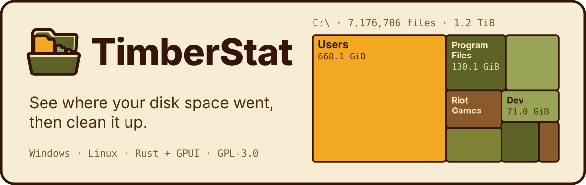
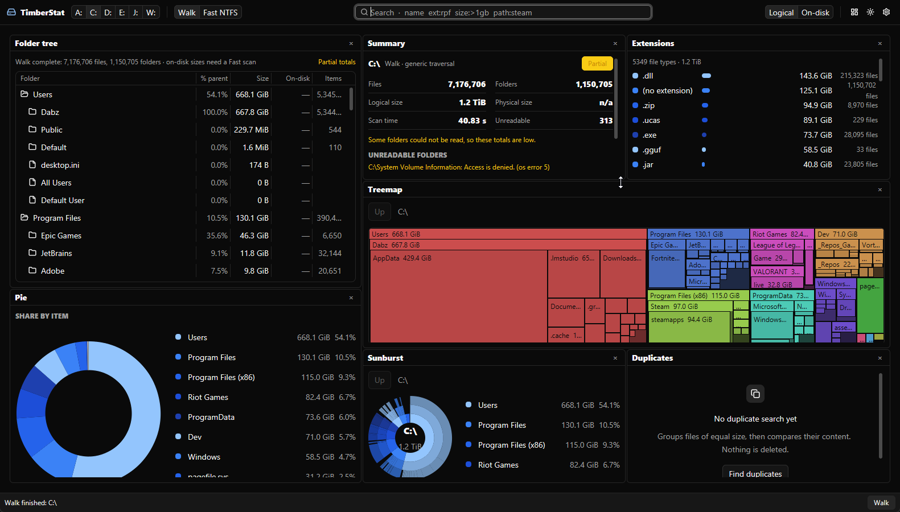

<p align="center">
  
</p>

<p align="center">
  <a href="https://github.com/the-homestead/TimberStat/releases"><b>Download</b></a> ·
  <a href="#features">Features</a> ·
  <a href="#search">Search</a> ·
  <a href="#build-from-source">Build</a> ·
  <a href="RELEASE.md">Releases</a>
</p>

TimberStat is a native disk analyser and file manager for **Windows 10/11**, with **Linux**
support in progress. Scan a drive, see what fills it as a folder tree, treemap, sunburst and
pie chart, find duplicate files, and delete, move, copy or rename right from the results.
Written in Rust with [GPUI](https://www.gpui.rs/) and [GPUI Kit](https://gpui-kit.com/).

<p align="center">
  
</p>

> **Early beta.** Windows is the main platform. Linux builds are best effort. Builds are not
> code-signed, so Windows SmartScreen warns on first run: choose **More info**, then **Run anyway**.

## Download

Get the latest build from [Releases](https://github.com/the-homestead/TimberStat/releases):

| File | What it is |
|---|---|
| `TimberStat-<version>-windows-x64-setup.exe` | Installer. Installs for your user only, no admin prompt. |
| `TimberStat-<version>-windows-x64.msi` | MSI installer for managed or per-machine installs. |
| `TimberStat-<version>-windows-x64-portable.zip` | Portable `timberstat.exe`, no install. |
| `TimberStat-<version>-linux-x64.AppImage` / `.deb` / `-portable.tar.gz` | Linux x64, best effort. |

Official releases come from version tags. A rolling **beta** pre-release is rebuilt after
every change to `main` that passes CI. Check downloads against `SHA256SUMS.txt`.

## Features

- **Two ways to scan.** *Walk* reads folders the normal way and needs no rights. *Fast NTFS*
  reads the volume's master file table directly. It is much faster on large drives, and it
  asks for administrator rights only when you click it.
- **Tiled workspace.** Folder tree, summary, extensions, treemap, sunburst, pie chart and
  duplicates sit side by side. Drag a widget's header to swap places, drag an edge to resize
  its neighbours, close what you don't need. The layout is saved.
- **Logical or on-disk size.** Switch every view between file size and space actually
  allocated (on-disk sizes come from a Fast NTFS scan).
- **Duplicates.** Groups files of equal size, compares a sample, then a BLAKE3 hash, then the
  bytes. It only reports; nothing is deleted for you.
- **File operations.** Right-click any item: delete to the Recycle Bin, delete permanently
  (you type to confirm), copy to, move to, rename. Each shows a preview first, can be
  cancelled, and reports what failed.
- **Honest totals.** Folders that cannot be read are listed, and totals are marked *partial*
  instead of looking complete.
- Light and dark theme, adjustable UI scale.

## Search

Type in the search bar. The tree lists only the matches and the folders that hold them; the
treemap and sunburst dim everything else.

```text
ext:iso,zip size:>1gb          big archives and disk images
path:steam modified:>1y        Steam files untouched for a year
*.log OR *.tmp                 wildcards, OR between terms
NOT attr:hidden (dup:yes)      not hidden, and part of a duplicate group
```

| Term | Matches |
|---|---|
| `report`, `*.iso`, `"my file"` | name contains, wildcard, or exact text |
| `path:Games` | full path contains |
| `ext:iso,zip` | extension in the list |
| `size:>1gb`, `size:1gb..2gb`, `size:empty` | size (binary units: 1 kb = 1024 bytes) |
| `alloc:>500mb` | on-disk size (Fast NTFS scans) |
| `modified:<7d`, `modified:2024-01-01..2024-06-30` | age (`d` `w` `m` `y`) or UTC dates |
| `type:file`, `type:dir`, `type:symlink` | entry kind |
| `attr:hidden`, `attr:readonly`, `attr:reparse` | attributes |
| `dup:yes`, `dup:no` | in the last duplicate search's groups |

Spaces mean AND. `OR`, `NOT` (or `!`) and parentheses work as you'd expect.

## Build from source

Needs Rust 1.95 or newer. On Linux, also the GPUI libraries:
`libxkbcommon-dev libxkbcommon-x11-dev libwayland-dev libxcb1-dev libvulkan-dev libfontconfig1-dev`.

```sh
git clone https://github.com/the-homestead/TimberStat.git
cd TimberStat
cargo run --release -p timberstat-app
```

Checks CI runs on every change:

```sh
cargo fmt --all -- --check
cargo clippy --workspace --all-targets -- -D warnings
cargo test --workspace
```

Installers are built with cargo-packager; see [RELEASE.md](RELEASE.md).

## Configuration

Settings are saved to `%APPDATA%\TimberStat\config\config.json` on Windows (the platform
config folder on Linux): theme, UI scale and widget layout. Logs go to
`%LOCALAPPDATA%\TimberStat\data\logs`.

For one run, override with environment variables: `HMSTD_THEME=dark` (`system`, `light`,
`dark`) and `HMSTD_LOG=debug` (default `info`).

## Project layout

| Path | Purpose |
|---|---|
| `crates/app` | Desktop app (GPUI + GPUI Kit) |
| `crates/scanner`, `crates/ntfs` | Folder walk and NTFS master file table reader |
| `crates/filesystem` | Scanned tree and size roll-up |
| `crates/search` | Query language |
| `crates/duplicates` | Duplicate detection |
| `crates/fileops` | Delete, copy, move and rename |
| `crates/core` | Configuration, logging, shared types |
| `docs/` | Architecture, research and plans |

## License

[GPL-3.0-only](LICENSE).
